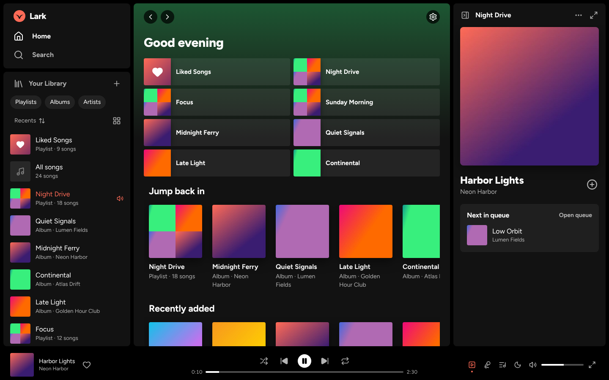
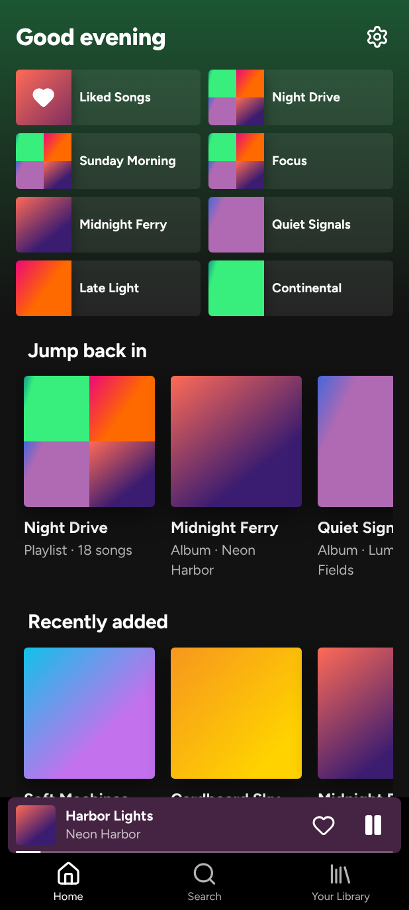
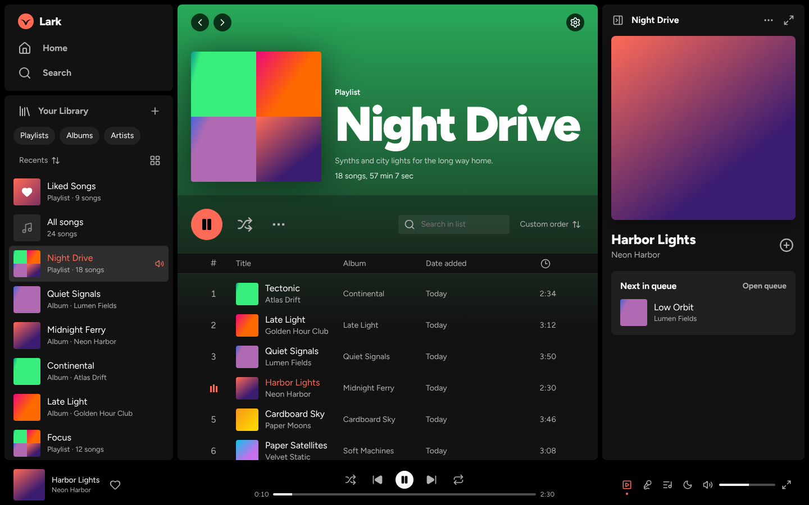
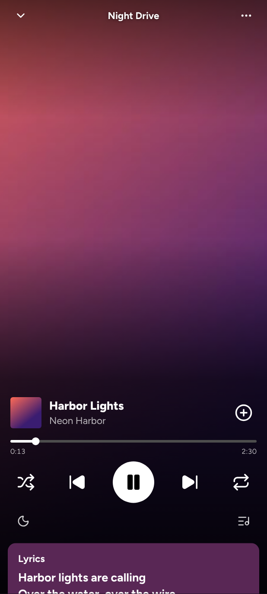

# Lark

A music player for music files you own, in the style of a premium streaming app: every song on demand, unlimited skips, shuffle, repeat, a queue, crossfade, lyrics, and no ads. It plays only the files you add. Nothing is streamed or uploaded: your music stays on each device.

Lark is an installable web app (PWA). It installs on Android and on computers like a normal app and works fully offline after the first visit.

**Live:** https://lark-music.onrender.com

| Desktop | Phone |
| --- | --- |
|  |  |
|  |  |

More in [docs/screenshots](docs/screenshots).

## Features

- **Add music** by file picker, drag and drop, or a whole folder (computer). MP3 plus whatever the browser plays: M4A/AAC, FLAC, OGG, Opus, WAV. Tags are read: title, artist, album, album artist, track, year, genre, cover art, lyrics. A matching `.lrc` file gives synced lyrics. Files without tags use the name (`Artist - Title.mp3`). Duplicates (same file content) are skipped. Imports run in the background with a progress bar.
- **Library**: Liked Songs, All songs, Recently played, automatic Albums and Artists pages from the tags, playlists with folders and pinning, "Your Library" with filters, sorting and list/grid view; on a computer, drag the edge of the sidebar to resize it or collapse it into an icon rail (right-click or long-press an album or artist to remove it from the list), and typo-tolerant search.
- **Editing**: song title, artist, album, cover (paste an image with Ctrl+V or "Paste image", upload and crop, or reuse another cover) and lyrics; bulk edit of several songs; playlist name, description and cover (default: a 4-cover mosaic). Your original files are never changed.
- **Playback**: shuffle (every song once before repeats), repeat off/all/one, queue ("Next in queue" before "Next from: …"; play next, add, reorder, remove, clear), previous restarts the song after 3 s, volume up to 150% (boosted above 100%, with a look-ahead limiter so it never distorts), crossfade 0–12 s, near-gapless playback, volume normalisation like Spotify's, with its Loud / Normal / Quiet levels (loudness from ReplayGain tags or measured to the EBU R128 standard), a 6-band equaliser with presets, a sleep timer (minutes or end of song), and synced lyrics. Lark remembers the song, position and queue after closing.
- **Controls**: lock screen, notification, Bluetooth/headphone buttons and keyboard media keys (Media Session), plus keyboard shortcuts on computers (listed in Settings).
- **Sync with Google Drive**: use Lark on the computer and the phone with the same library; see below.
- **Export / import**: one `.zip` with everything (songs as-is, covers, edits, playlists, likes, history, settings). It is written as a stream, so it needs no extra memory or disk space, and it supports libraries over 4 GB (ZIP64). Import replaces or merges.

## Install on your Samsung phone

1. Open the Lark address in **Chrome** (Samsung Internet works too).
2. Tap the **⋮** menu → **Add to Home screen** → **Install**. Lark now opens like an app, without the browser bar.
3. Open Lark → **Add music files** (or **Import library** if you exported one on another device).
4. Lark asks the browser to protect its storage. Installing the app is what normally grants this; Settings → Storage shows whether it is protected.

On a computer, open the address in Chrome or Edge and click the install icon in the address bar.

## Move your library to another device

1. On the old device: **Settings → Export library**. A file `lark-library-YYYY-MM-DD.zip` is saved to Downloads. Keep Lark open until it finishes.
2. Move the file with a USB cable, Quick Share or Google Drive.
3. On the new device: **Settings → Import library**, pick the file, then choose:
   - **Merge**: adds songs, playlists, likes and history. Songs you already have (same file content) are not duplicated.
   - **Replace**: makes the library exactly like the export.

## Sync with Google Drive (computer ⇄ phone)

Lark can keep your library the same on all your devices through your own Google Drive. It puts your songs, covers, edits, playlists, folders, likes, history and Your Library choices in a folder called **Lark**. Each device picks up the changes and keeps its own copy of the songs, so music still plays offline. Lark uses Google's `drive.file` permission, so it can only see the files it creates; nothing else in your Drive.

### One-time setup (about 10 minutes, on a computer)

Google needs to know that Lark is allowed to ask for your Drive. You do this once, in Google's developer console. It's free, and no credit card is needed.

1. Open https://console.cloud.google.com and sign in with **the Google account whose Drive should hold your music**. If it asks you to accept terms of service, accept them.
2. **Create a project:** click the project picker at the top left (it may say "Select a project"), then **New project**. Name it `Lark` and click **Create**. When it's done, make sure **Lark** is the selected project in the picker.
3. **Turn on the Drive API:** open https://console.cloud.google.com/apis/library/drive.googleapis.com and click **Enable**.
4. **Describe the app:** open https://console.cloud.google.com/auth/overview and click **Get started**.
   - App name: `Lark`. User support email: your email. Click **Next**.
   - Audience: **External**. Click **Next**.
   - Contact information: your email. Click **Next**.
   - Tick "I agree to the Google API Services: User Data Policy", then click **Continue** and **Create**.
5. **Choose the permission:** open https://console.cloud.google.com/auth/scopes and click **Add or remove scopes**. In the filter box type `drive.file`, tick the row `.../auth/drive.file` ("See, edit, create, and delete only the specific Google Drive files you use with this app"), click **Update**, then **Save** at the bottom.
6. **Publish it** so the sign-in doesn't expire every week: open https://console.cloud.google.com/auth/audience, click **Publish app** under "Publishing status", then **Confirm**. This permission doesn't need a review by Google.
   (If you'd rather leave it in "Testing", add your Gmail address under **Test users** instead. Google then asks you to approve Lark again every 7 days.)
7. **Create the sign-in ID:** open https://console.cloud.google.com/auth/clients and click **Create client**.
   - Application type: **Web application**. Name: `Lark`.
   - Under **Authorized JavaScript origins**, click **Add URI** and enter exactly `https://lark-music.onrender.com` (no slash at the end).
   - Leave "Authorized redirect URIs" empty and click **Create**.
   - Copy the **Client ID**. It looks like `1234567890-abc123def456.apps.googleusercontent.com`. You don't need the client secret.
8. **Give Lark the ID** in one of two ways:
   - Paste the Client ID to Claude (it's not a password), and it will be added to the Render site.
   - Or add it yourself: in the [Render dashboard](https://dashboard.render.com) open **lark-music**, then **Environment**, then **Add Environment Variable**. Key: `LARK_GOOGLE_CLIENT_ID`. Value: the Client ID. Choose **Save, rebuild, and deploy**.
9. After the deploy (about a minute), close every Lark window and open Lark again. It updates itself.

### Connect your devices

1. **On the computer** (the one that has your music): open **Settings → Sync with Google Drive → Connect Google Drive**, choose your Google account and click **Allow**.
   - If Google shows "Google hasn't verified this app", click **Advanced → Go to Lark (unsafe)**. It's your own app.
   - If Google shows a tick box for Drive access, tick it.
   - Lark then uploads your library. Keep Lark open until Settings says **Up to date**; a progress bar shows how far it is. Your Google Drive now has a **Lark** folder.
2. **On the phone:** open Lark, go to **Settings → Sync with Google Drive → Connect Google Drive**, and sign in with **the same Google account**. Connect on **Wi-Fi** and keep Lark open while the songs download. New songs appear straight away; songs still downloading look faded, with a small cloud icon.

### Everyday use

- Lark syncs by itself while it's open: a few seconds after any change, every few minutes, and whenever you come back to it. When you open Lark on the other device, it picks up the changes.
- **One tap after a while:** Google only allows browser apps a one-hour sign-in. When it has run out, Lark shows **Sync with Google Drive → Sync** at the bottom (and the cloud button turns orange). Tap it; a Google window flashes and closes by itself, and syncing continues.
- **On mobile data**, new songs wait for Wi-Fi. Settings shows how many are waiting, with a **Transfer them now** link.
- **Deleting a song deletes it on every device.** Lark also moves its file to the bin in Google Drive, which Google empties after 30 days.
- Don't rename, move or edit the files inside the **Lark** folder in Google Drive yourself.
- Free Google Drive has 15 GB, shared with Gmail and Google Photos. Check it at https://drive.google.com (bottom left).
- To stop syncing a device: **Settings → Sync with Google Drive → Disconnect**. Your music stays on that device and in Drive.

## Deploy (Render, free static site)

The app is static files built into `dist/`. Render builds it from this repository.

1. Sign in at [dashboard.render.com](https://dashboard.render.com) (free account). If GitHub isn't connected yet: **Account settings → Git providers → Connect GitHub**, and allow access to the `lark` repository.
2. Click **New → Static Site** and pick **PolynomialI/lark**.
3. Fill in:
   - **Branch**: `main`
   - **Build command**: `npm ci && npm run build`
   - **Publish directory**: `dist`
4. Click **Deploy Static Site**. After a minute or two the site is live at `https://<name>.onrender.com`.
5. Open that address on your phone and install it (see above).

Render static sites are free and don't sleep. Every push to `main` deploys automatically.

**Updates never touch your library.** Your music and library data live in the browser's private storage (IndexedDB and OPFS) on each device. A new version only replaces the app's own cached files. It switches over by itself the next time you open Lark (or within a few seconds, if nothing is playing); while music is playing, Lark instead shows "A new version of Lark is ready → Restart" until you tap it.

## Development

```bash
npm install
```

```bash
npm run dev      # build and serve on http://localhost:5173
```

```bash
npm test         # build, then run the Playwright tests (Chromium)
```

The tests need `ffmpeg` and `python3`. They generate their own music, including a 1,000-file library and a library over 1 GB; the ZIP64 test temporarily writes a 4.3 GB file. Screenshots are regenerated into `docs/screenshots` by `tests/screenshots.spec.mjs`.

What the tests check:

| Test file | What it checks |
| --- | --- |
| `import.spec.mjs` | Tagged and untagged MP3s, covers, embedded and `.lrc` lyrics, duplicate skipping; 1,000 files import with progress while the app stays responsive |
| `playback.spec.mjs` | Repeat cycle, shuffle (no repeats until all played), queue order and editing, previous, near-gapless hand-over, crossfade overlap, sleep timer, resume after reload |
| `edits.spec.mjs` | Song edits, cover upload and crop, cover paste, bulk edit, likes, playlist create/rename/cover/add/reorder, folders, pin, duplicate, all surviving a reload |
| `export-import.spec.mjs` | Export → clear all storage → import gives back the exact same library (including a library over 1 GB); merge doesn't duplicate |
| `zip64.spec.mjs` | A zip over 4 GB is written as ZIP64 by client-zip and read back by Lark's importer |
| `offline.spec.mjs` | Works with the network off after the first visit; passes Chrome's installability checks; an app update keeps the library and switches over by itself |
| `playback.spec.mjs` (panel) | The desktop "Now playing view" panel follows the current song and switches with the queue |
| `sync.spec.mjs` | Two devices sync through a stand-in for Google Drive: everything copies over (including audio for offline play), renames/likes/deletions go both ways, changes on both devices at once are both kept, the one-tap sign-in prompt, and waiting for Wi-Fi on mobile data |
| `audio.spec.mjs` | The volume-boost limiter never clips, doesn't pump and leaves normal levels untouched; loudness matches ffmpeg's EBU R128 meter; Spotify's Normal/Loud levels give the right gain |
| `layout.spec.mjs` | The desktop sidebar resizes by dragging its edge, collapses into an icon rail, is remembered, and expands again |
| `phone.spec.mjs` | Phone layout: tabs, mini-player swipe to skip, swipe up/down for the full player, bottom-sheet menus, Back closes sheets |

## How it's built

- Plain JavaScript, bundled with esbuild. Main app ≈ 43 KB gzipped. The tag reader is loaded only when you add music.
- Libraries, at exact versions: [client-zip](https://github.com/Touffy/client-zip) 2.5.1 (streaming ZIP64 writer, ≈ 3 KB) and [music-metadata](https://github.com/Borewit/music-metadata) 12.3.3 (tag reader, ≈ 86 KB gzipped, in a worker). The import side of `.zip` files is a small reader in `src/js/zip-import.js`.
- Audio files are stored in the Origin Private File System, and library data in IndexedDB.
- Playback uses two `<audio>` elements, so the next song is already loaded. Web Audio (crossfade, EQ, normalisation) is only switched on while one of those features is on. With all three off, Lark plays through the plain audio element, which is the most reliable for playing with the screen off.
- Near-gapless: the next song starts about 10 ms before the current one ends. In tests the hand-over overlaps by about 40 ms and never leaves a gap. Truly sample-accurate gapless would need whole songs decoded into memory.
- Font: [Figtree](https://github.com/erikdkennedy/figtree) (SIL Open Font License). Icons: [Lucide](https://lucide.dev) (ISC).
